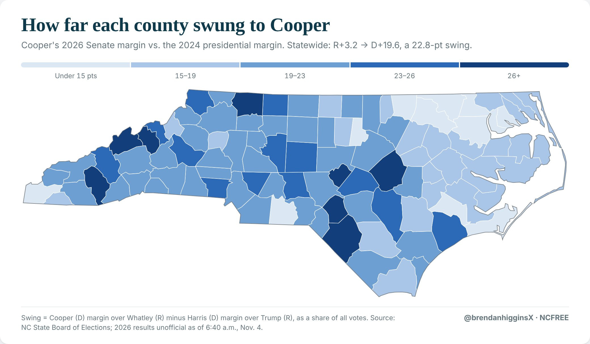
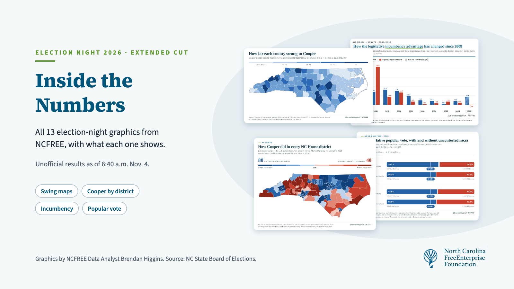
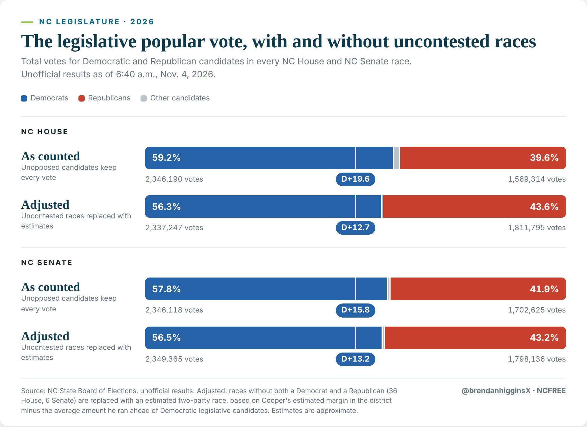
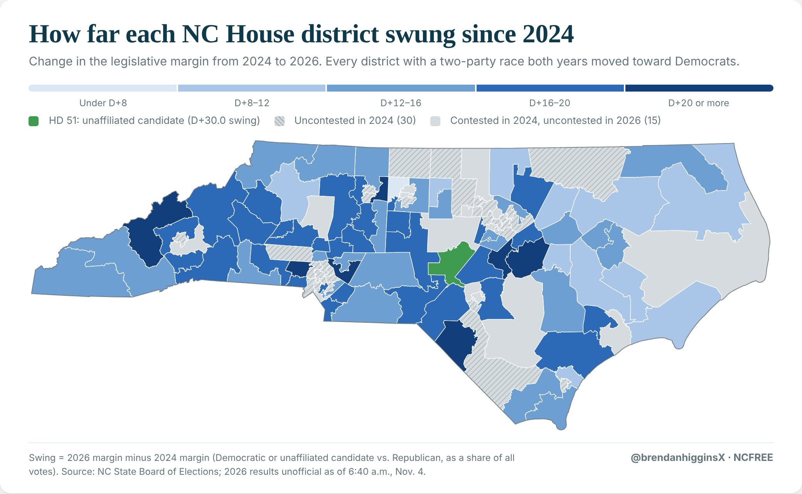
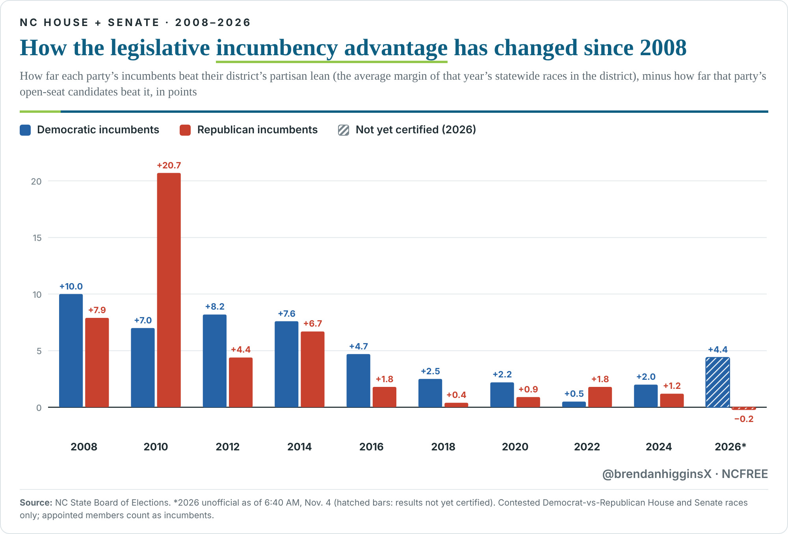
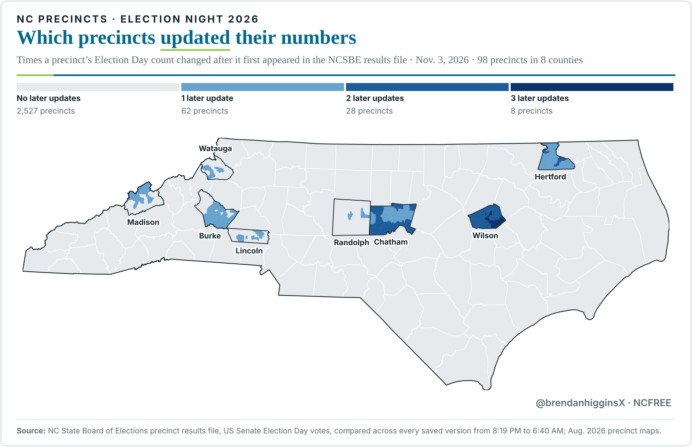

Explore the 2026 U.S. Senate and Gubernatorial races across all 50 states. Select any state from the **dropdown menu** or **click directly on the interactive map** to view election details, candidates, and pictures.

```{=html}
<link rel="stylesheet" href="https://unpkg.com/leaflet@1.9.4/dist/leaflet.css" />
<script src="https://unpkg.com/leaflet@1.9.4/dist/leaflet.js"></script>

<div class="selector-box">
  <label for="state-select"><i class="bi bi-geo-alt-fill"></i> Choose a State to View Election Details:</label>
  <select id="state-select" class="state-dropdown">
    <option value="" disabled selected>-- Select a State --</option>
  </select>
</div>

<div class="dashboard-container">
  <!-- Map Section -->
  <div>
    <div id="election-map"></div>
    <div class="map-legend">
      <div class="legend-item"><span class="legend-color" style="background: #1e3a8a;"></span> Solid Dem</div>
      <div class="legend-item"><span class="legend-color" style="background: #3b82f6;"></span> Lean / Likely Dem</div>
      <div class="legend-item"><span class="legend-color" style="background: #eab308;"></span> Tossup / Battleground</div>
      <div class="legend-item"><span class="legend-color" style="background: #ef4444;"></span> Lean / Likely Rep</div>
      <div class="legend-item"><span class="legend-color" style="background: #991b1b;"></span> Solid Rep</div>
      <div class="legend-item"><span class="legend-color" style="background: #64748b;"></span> Other / Non-traditional</div>
    </div>
  </div>

  <!-- State Details Card -->
  <div>
    <div id="state-card" class="state-details-card">
      <div class="state-card-header">
        
        <div class="state-header-text">
          <h3 id="state-name">North Carolina</h3>
          <span id="state-rating" class="rating-badge" style="background: #dbeafe; color: #1e40af;">Key Historic Shift (Cooper +19.6)</span>
        </div>
      </div>

      <div class="race-section">
        <div class="race-title">U.S. Senate (2026)</div>
        <div id="senate-info" class="race-content">Class 2: Thom Tillis seat (won by Roy Cooper, D)</div>
      </div>

      <div class="race-section">
        <div class="race-title">Governor (2026)</div>
        <div id="governor-info" class="race-content">No gubernatorial race (held in 2024, won by Josh Stein)</div>
      </div>

      <div class="race-notes">
        <strong>Outlook & Notes:</strong>
        <p id="state-notes" style="margin: 6px 0 0 0;">Major focus of project; Roy Cooper won by 19.6 points in 2026, marking a 22.8-point swing from 2024.</p>
      </div>

      <div id="nc-spotlight" class="special-nc-spotlight">
        <strong>Featured 2026 Graphic (NC Swing Map):</strong>
        
      </div>
    </div>
  </div>
</div>

<script>
document.addEventListener("DOMContentLoaded", function() {
  const map = L.map("election-map").setView([38.5, -96.5], 4);

  L.tileLayer("https://{s}.basemaps.cartocdn.com/light_nolabels/{z}/{x}/{y}{r}.png", {
    attribution: '&copy; <a href="https://carto.com/">CARTO</a>',
    maxZoom: 7,
    minZoom: 3
  }).addTo(map);

  let geojsonLayer;
  let statesData = {};
  let currentSelectedLayer = null;

  function getColor(rating) {
    if (!rating) return "#94a3b8";
    const r = rating.toLowerCase();
    if (r.includes("solid dem")) return "#1e3a8a";
    if (r.includes("lean dem") || r.includes("likely dem")) return "#3b82f6";
    if (r.includes("tossup") || r.includes("battleground") || r.includes("competitive")) return "#eab308";
    if (r.includes("lean rep") || r.includes("likely rep")) return "#ef4444";
    if (r.includes("solid rep")) return "#991b1b";
    return "#3b82f6";
  }

  function style(feature) {
    const isSelected = feature.properties.abbr === "NC";
    return {
      fillColor: getColor(feature.properties.rating),
      weight: isSelected ? 3 : 1.5,
      opacity: 1,
      color: isSelected ? "#0f172a" : "#ffffff",
      fillOpacity: 0.75
    };
  }

  function highlightFeature(e) {
    const layer = e.target;
    if (layer !== currentSelectedLayer) {
      layer.setStyle({
        weight: 3,
        color: "#1e293b",
        fillOpacity: 0.95
      });
      layer.bringToFront();
      if (currentSelectedLayer) currentSelectedLayer.bringToFront();
    }
  }

  function resetHighlight(e) {
    const layer = e.target;
    if (layer !== currentSelectedLayer) {
      geojsonLayer.resetStyle(layer);
    }
  }

  function updateCard(props) {
    document.getElementById("state-name").textContent = props.name;
    document.getElementById("senate-info").textContent = props.senate || "No regular Senate election in 2026";
    document.getElementById("governor-info").textContent = props.governor || "No gubernatorial election in 2026";
    document.getElementById("state-notes").textContent = props.notes || "No special notes recorded.";
    
    const ratingEl = document.getElementById("state-rating");
    ratingEl.textContent = props.rating || "Unrated";
    const col = getColor(props.rating);
    ratingEl.style.backgroundColor = col;
    ratingEl.style.color = "#ffffff";

    if (props.abbr) {
      document.getElementById("state-flag").src = "https://flagcdn.com/w320/us-" + props.abbr.toLowerCase() + ".png";
    }

    const ncSpotlight = document.getElementById("nc-spotlight");
    if (props.abbr === "NC") {
      ncSpotlight.style.display = "block";
    } else {
      ncSpotlight.style.display = "none";
    }
  }

  function selectState(abbr, triggerZoom = true) {
    const select = document.getElementById("state-select");
    select.value = abbr;

    let targetLayer = null;
    geojsonLayer.eachLayer(function(layer) {
      if (layer.feature.properties.abbr === abbr) {
        targetLayer = layer;
      }
    });

    if (targetLayer) {
      if (currentSelectedLayer) {
        geojsonLayer.resetStyle(currentSelectedLayer);
      }
      currentSelectedLayer = targetLayer;
      targetLayer.setStyle({
        weight: 3.5,
        color: "#000000",
        fillOpacity: 0.95
      });
      targetLayer.bringToFront();

      updateCard(targetLayer.feature.properties);

      if (triggerZoom) {
        map.fitBounds(targetLayer.getBounds(), { maxZoom: 6, padding: [20, 20] });
      }
    }
  }

  fetch("data/us_states_elections_2026.geojson")
    .then(r => r.json())
    .then(data => {
      // Sort states alphabetically for dropdown
      const sortedStates = data.features
        .filter(f => f.properties.abbr)
        .sort((a, b) => a.properties.name.localeCompare(b.properties.name));

      const select = document.getElementById("state-select");
      sortedStates.forEach(f => {
        const opt = document.createElement("option");
        opt.value = f.properties.abbr;
        opt.textContent = f.properties.name + " (" + f.properties.abbr + ")";
        select.appendChild(opt);
      });

      geojsonLayer = L.geoJson(data, {
        style: style,
        onEachFeature: function(feature, layer) {
          layer.on({
            mouseover: highlightFeature,
            mouseout: resetHighlight,
            click: function(e) {
              selectState(feature.properties.abbr, false);
            }
          });
          layer.bindTooltip("<strong>" + feature.properties.name + "</strong><br>" + (feature.properties.rating || ""), { sticky: true });
        }
      }).addTo(map);

      select.addEventListener("change", function(e) {
        selectState(e.target.value, true);
      });

      // Default select North Carolina
      selectState("NC", false);
    });
});
</script>
```

---

## 2026 Election Graphics Gallery

Explore key election-night maps and data graphics from the 2026 elections in North Carolina:

:::: {.gallery-grid}

::: {.gallery-card}

<div class="gallery-card-body">
<div class="gallery-card-title">Inside the Numbers</div>
<p class="gallery-card-desc">Overview of all 13 election-night graphics analyzing the 2026 North Carolina election shift.</p>
</div>
:::

::: {.gallery-card}

<div class="gallery-card-body">
<div class="gallery-card-title">County Swing to Cooper</div>
<p class="gallery-card-desc">Every county shifted toward Democrats at the top of the ticket, led by mountain counties and suburban Raleigh.</p>
</div>
:::

::: {.gallery-card}

<div class="gallery-card-body">
<div class="gallery-card-title">Legislative Popular Vote</div>
<p class="gallery-card-desc">Democratic candidates earned 59.2% of all votes cast across NC House races in 2026.</p>
</div>
:::

::: {.gallery-card}

<div class="gallery-card-body">
<div class="gallery-card-title">NC House District Swings</div>
<p class="gallery-card-desc">Comparing each district's 2026 result with 2024; typical districts moved 16.3 points toward Democrats.</p>
</div>
:::

::: {.gallery-card}

<div class="gallery-card-body">
<div class="gallery-card-title">Incumbency Advantage (2008–2026)</div>
<p class="gallery-card-desc">Historical tracking of party incumbent performance relative to open-seat nominees.</p>
</div>
:::

::: {.gallery-card}

<div class="gallery-card-body">
<div class="gallery-card-title">Precinct Reporting Updates</div>
<p class="gallery-card-desc">Locations of precincts that updated their Election Day totals after first reporting overnight.</p>
</div>
:::

::::

---

### Data Sources

- **State Board of Elections (NCSBE):** Official precinct-level election return files.
- **North Carolina FreeEnterprise Foundation (NCFREE):** Race calls, ratings, and district estimates.
- **National Data:** Compiled 2026 U.S. Senate Class 2 and Gubernatorial election projections.
